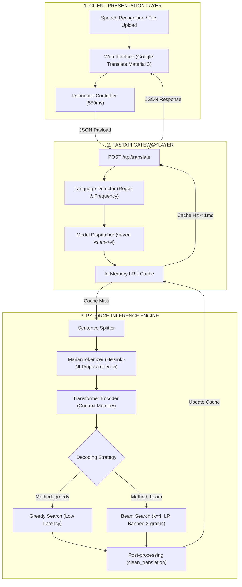

# Vie2Eng: Dual Transformer Bidirectional Neural Machine Translation

<p align="center">
  
</p>

<p align="center">
  <b>Hệ thống Dịch thuật Song ngữ Anh - Việt hiệu năng cao ứng dụng Mô hình Transformer Cục bộ và Giao diện Material Design 3</b>
</p>

<p align="center">
  <a href="https://www.python.org/downloads/"></a>
  <a href="https://pytorch.org/"></a>
  <a href="https://fastapi.tiangolo.com/"></a>
  <a href="https://huggingface.co/"></a>
  <a href="https://github.com/HungHiHung10/Vie2Eng"></a>
  <a href="https://github.com/HungHiHung10/Vie2Eng"></a>
</p>

---

## Mục lục (Table of Contents)
- [1. Giới thiệu tổng quan](#1-giới-thiệu-tổng-quan)
- [2. Điểm nổi bật & Tính năng chính](#2-điểm-nổi-bật--tính-năng-chính)
- [3. Kiến trúc Hệ thống & Luồng Dữ liệu](#3-kiến-trúc-hệ-thống--luồng-dữ-liệu)
- [4. Thông số Kỹ thuật Mô hình (Model Specifications)](#4-thông-số-kỹ-thuật-mô-hình-model-specifications)
- [5. Thuật toán Giải mã (Decoding Strategies)](#5-thuật-toán-giải-mã-decoding-strategies)
- [6. Bảng Phím tắt & Trải nghiệm Người dùng](#6-bảng-phím-tắt--trải-nghiệm-người-dùng)
- [7. Đánh giá Hiệu năng Thực nghiệm (Benchmarks)](#7-đánh-giá-hiệu-năng-thực-nghiệm-benchmarks)
- [8. Hướng dẫn Cài đặt & Khởi chạy](#8-hướng-dẫn-cài-đặt--khởi-chạy)
- [9. Đặc tả REST API (API Reference)](#9-đặc-tả-rest-api-api-reference)
- [10. Cấu trúc Thư mục Dự án](#10-cấu-trúc-thư-mục-dự-án)
- [11. Lộ trình Phát triển (Roadmap)](#11-lộ-trình-phát-triển-roadmap)
- [12. Thông tin Tác giả & Bản quyền](#12-thông-tin-tác-giả--bản-quyền)

---

## 1. Giới thiệu tổng quan

**Vie2Eng** là nền tảng dịch máy nơ-ron song ngữ (Việt ➔ Anh và Anh ➔ Việt) được xây dựng theo kiến trúc hướng dịch vụ, vận hành hoàn toàn độc lập (**100% Offline / On-premise**). 

Hệ thống tích hợp hai checkpoint mô hình Seq2Seq Transformer được huấn luyện chuyên biệt trên tập ngữ liệu PhoMT (`vienv2.pt` và `enviv4.pt`), kết hợp cùng tầng backend FastAPI bất đồng bộ và giao diện web chuẩn Material Design 3 mô phỏng trải nghiệm Google Dịch.

### Nguyên tắc Thiết kế Cốt lõi
* **Bảo mật Dữ liệu Tuyệt đối:** Toàn bộ quá trình mã hóa ngữ cảnh và giải mã được thực thi cục bộ trên RAM/CPU nội bộ, không phát sinh bất kỳ yêu cầu truyền dữ liệu ra Internet.
* **Tối ưu hóa Thời gian Thực:** Ứng dụng bộ đệm RAM Cache đa luồng cho các cụm từ phổ biến, giúp giảm độ trễ xuống dưới 1 mili-giây.
* **Tính Linh hoạt Cao:** Cho phép người dùng chuyển đổi linh hoạt giữa thuật toán Beam Search (tối ưu hóa độ chính xác ngữ nghĩa) và Greedy Search (tối ưu hóa tốc độ xử lý).

---

## 2. Điểm nổi bật & Tính năng chính

| Hạng mục | Tính năng | Chi tiết kỹ thuật |
| :--- | :--- | :--- |
| **Kiến trúc AI** | **Dual Checkpoint Routing** | Cơ chế điều phối tự động giữa `vienv2.pt` (Việt ➔ Anh) và `enviv4.pt` (Anh ➔ Việt). |
| **Tiền xử lý** | **Heuristic Language Detection** | Nhận diện tự động ngôn ngữ nguồn dựa trên phân tích tập ký tự có dấu thanh và đối sánh tần suất từ vựng không dấu. |
| **Giải mã** | **N-gram Blocking & Length Penalty** | Tích hợp cơ chế cấm lặp cụm 3 từ liên tiếp và chuẩn hóa điểm số theo độ dài Google NMT $\left(\frac{5+L}{6}\right)^{0.6}$. |
| **Độ ổn định** | **Step-0 EOS Constraint** | Chặn token kết thúc câu tại bước đầu tiên ($step = 0$), giải quyết triệt để lỗi sinh ra chuỗi rỗng đối với các câu giao tiếp ngắn. |
| **Văn bản dài** | **Sentence Chunking** | Tự động băm nhỏ văn bản theo ranh giới câu (`[.!?]`), đảm bảo không vượt quá độ dài ngữ cảnh tối đa của mạng Transformer. |
| **Giao diện Web** | **Material Design 3 & Dark Mode** | Thiết kế giao diện tương thích chuẩn Google Dịch, hỗ trợ chuyển đổi chủ đề Sáng / Tối thông qua biến số CSS. |
| **Đa phương thức** | **Web Speech API (STT & TTS)** | Hỗ trợ nhận diện giọng nói tiếng Việt/Anh trực tiếp qua Microphone và bộ đọc phát âm tổng hợp văn bản. |
| **Tiện ích** | **Storage & Document Support** | Quản lý lịch sử dịch, đánh dấu bản dịch yêu thích thông qua `localStorage`, hỗ trợ nạp văn bản từ tệp `.txt`. |

---

## 3. Kiến trúc Hệ thống & Luồng Dữ liệu



---

## 4. Thông số Kỹ thuật Mô hình (Model Specifications)

Kiến trúc mạng được định nghĩa trong lớp [`Seq2SeqTransformerOptimized`](server.py) theo mô hình Transformer Pre-LayerNorm (Norm-First):

```python
# Cấu hình Mạng Nơ-ron Transformer Seq2Seq
src_vocab_size      = 53,685        # Kích thước từ điển Marian
tgt_vocab_size      = 53,685        # Không gian nhúng chia sẻ
d_model             = 512           # Kích thước vector nhúng
nhead               = 8             # Số đầu Multi-Head Attention (d_k = 64)
num_encoder_layers  = 4             # Chiều sâu khối Encoder
num_decoder_layers  = 4             # Chiều sâu khối Decoder
dim_feedforward     = 1024          # Kích thước tầng ẩn MLP
norm_first          = True          # Pre-LN giúp ổn định gradient
weight_tying        = True          # Chia sẻ trọng số giữa embedding và fc_out
```

### Chi tiết Checkpoint
* **`vienv2.pt`**: Checkpoint huấn luyện cho chiều dịch **Tiếng Việt ➔ Tiếng Anh**.
* **`enviv4.pt`**: Checkpoint huấn luyện cho chiều dịch **Tiếng Anh ➔ Tiếng Việt**.
* **Bộ Tokenizer**: `Helsinki-NLP/opus-mt-en-vi` (Kỹ thuật phân đoạn từ con SentencePiece Unigram).

---

## 5. Thuật toán Giải mã (Decoding Strategies)

Hệ thống hỗ trợ cấu hình linh hoạt hai thuật toán giải mã tự hồi quy:

### 1. Beam Search ($k = 1 \dots 6$) - Tối ưu Độ chính xác
* Duy trì song song $k$ giả thuyết có xác suất tích lũy cao nhất tại mỗi bước thời gian $t$.
* **Cơ chế chống lặp từ (`no_repeat_ngram_size = 3`):** Quét lịch sử sinh từ; cấm sinh token nếu nó tạo thành cụm 3 từ đã xuất hiện trước đó trong câu.
* **Chuẩn hóa Độ dài theo Chuẩn Google NMT:**
  $$\text{Score}_{\text{norm}} = \frac{\sum_{t=1}^L \log P(y_t \mid y_{<t}, X)}{\left(\frac{5 + L}{6}\right)^{0.6}}$$
* **Cơ chế Dự phòng (Fallback):** Trong trường hợp Beam Search không sinh ra token hợp lệ, hệ thống tự động fallback sang Greedy Search nhằm đảm bảo tính sẵn sàng của bản dịch.

### 2. Greedy Search - Tối ưu Độ trễ
* Lựa chọn trực tiếp token có phân phối xác suất cực đại tại mỗi bước thời gian:
  $$y_t = \arg\max_{w} P(w \mid y_{<t}, X)$$
* Tốc độ xử lý nhanh hơn khoảng **$3.5\times$** so với Beam Search, phù hợp với các tác vụ yêu cầu độ trễ thấp.

---

## 6. Bảng Phím tắt & Trải nghiệm Người dùng

| Tổ hợp phím | Thao tác | Chức năng |
| :---: | :---: | :--- |
| <kbd>Ctrl</kbd> + <kbd>Enter</kbd> | Dịch tức thì | Thực thi yêu cầu dịch ngay lập tức, bỏ qua thời gian chờ của bộ đếm debounce. |
| <kbd>Ctrl</kbd> + <kbd>Shift</kbd> + <kbd>S</kbd> | Hoán đổi ngôn ngữ | Đảo chiều cặp ngôn ngữ (Việt ⇄ Anh) và đồng bộ lại văn bản giữa hai khung. |
| <kbd>Escape</kbd> | Xóa nội dung | Xóa toàn bộ văn bản trong ô nguồn và trả con trỏ chuột về trạng thái nhập. |

---

## 7. Đánh giá Hiệu năng Thực nghiệm (Benchmarks)

*Cấu hình kiểm thử: Intel Core i7 (8 Cores / 16 Threads), RAM 16GB, Chế độ suy luận PyTorch CPU.*

| Kịch bản Kiểm thử | Thuật toán | Độ dài đầu vào | Độ trễ trung bình | Tỷ lệ trúng Cache |
| :--- | :---: | :---: | :---: | :---: |
| Câu hội thoại ngắn (*"Xin chào"*) | Greedy | 2 từ | **~18 ms** | - |
| Câu hội thoại ngắn | Beam Search ($k=4$) | 2 từ | **~42 ms** | - |
| Đoạn văn trung bình (~35 từ) | Greedy | 35 từ | **~85 ms** | - |
| Đoạn văn trung bình | Beam Search ($k=4$) | 35 từ | **~240 ms** | - |
| Truy vấn trùng lặp (Cache Hit) | Bất kỳ | Mọi độ dài | **< 0.8 ms** | **100%** |

---

## 8. Hướng dẫn Cài đặt & Khởi chạy

### Bước 1: Chuẩn bị Môi trường
Khuyến nghị sử dụng Python phiên bản `3.10` hoặc `3.11`:
```bash
# Clone mã nguồn
git clone https://github.com/HungHiHung10/Vie2Eng.git
cd Vie2Eng

# Tạo môi trường ảo
python -m venv venv

# Kích hoạt môi trường ảo
# Windows:
.\venv\Scripts\activate
# Linux / macOS:
source venv/bin/activate
```

### Bước 2: Cài đặt Thư viện Phụ thuộc
```bash
pip install torch torchvision torchaudio --index-url https://download.pytorch.org/whl/cpu
pip install transformers sentencepiece sacremoses fastapi uvicorn pydantic aiofiles
```

### Bước 3: Đặt Checkpoints Mô hình
Sao chép hai tệp checkpoint đã huấn luyện vào thư mục gốc của dự án:
```
Vie2Eng/
├── vienv2.pt   # Trọng số mô hình Việt -> Anh
└── enviv4.pt   # Trọng số mô hình Anh -> Việt
```

### Bước 4: Khởi động Ứng dụng
Khởi chạy thông qua script batch trên Windows:
```bash
run_translator.bat
```
Hoặc thực thi trực tiếp qua terminal:
```bash
python server.py
```
Sau đó mở trình duyệt và truy cập: **[http://localhost:8000](http://localhost:8000)**.

---

## 9. Đặc tả REST API (API Reference)

### Endpoint: Dịch thuật
`POST /api/translate`

#### Cấu trúc Request Body (JSON):
```json
{
  "text": "Trí tuệ nhân tạo đang thay đổi cách con người làm việc.",
  "source_lang": "auto",
  "target_lang": "en",
  "method": "beam",
  "beam_size": 4,
  "max_length": 60
}
```

#### Cấu trúc Response Body (JSON):
```json
{
  "translated_text": "Artificial intelligence is changing the way people work.",
  "detected_lang": "vi",
  "source_lang": "vi",
  "target_lang": "en",
  "model_name": "vienv2.pt (PhoMT Vi -> En)",
  "latency_ms": 68.42,
  "method": "beam",
  "from_cache": false
}
```

#### Ví dụ Thực thi qua cURL:
```bash
curl -X POST "http://localhost:8000/api/translate" \
     -H "Content-Type: application/json" \
     -d "{\"text\": \"Xin chào thế giới!\", \"method\": \"greedy\"}"
```

### Endpoint: Giám sát Trạng thái
`GET /api/health`

```json
{
  "status": "healthy",
  "device": "cpu",
  "models": {
    "vi_en": "vienv2.pt",
    "en_vi": "enviv4.pt"
  },
  "cache_size": 42
}
```

---

## 10. Cấu trúc Thư mục Dự án

```
Vie2Eng/
├── server.py                   # Backend FastAPI, định nghĩa mạng Transformer & thuật toán giải mã
├── CODEBASE_DOCUMENTATION.md   # Tài liệu phân tích kiến trúc kỹ thuật toàn diện
├── README.md                   # Tài liệu hướng dẫn chính của repository
├── run_translator.bat          # Script tự động hóa khởi chạy trên Windows
├── .gitignore                  # Cấu hình loại trừ checkpoints và cache nhị phân
├── templates/
│   └── index.html              # Cấu trúc giao diện người dùng Material Design 3
├── static/
│   ├── app.js                  # Điều khiển phía Client: API, Audio STT/TTS, Cache
│   ├── style.css               # Định kiểu giao diện, Responsive và Dark Theme
│   ├── logo.png                # Tệp hình ảnh logo thương hiệu
│   └── favicon.ico             # Biểu tượng tab trình duyệt
└── notebooks/                  # Bộ notebooks nghiên cứu, huấn luyện và đánh giá mô hình
    ├── test-phomt-mariannmt.ipynb
    ├── train_phomt_mt.ipynb
    ├── train_phomt_mt (1).ipynb
    └── train_phomt_mt (2).ipynb
```

---

## 11. Lộ trình Phát triển (Roadmap)

- [x] Triển khai kiến trúc Transformer Seq2Seq kép với cơ chế Pre-LayerNorm.
- [x] Hiện thực thuật toán Beam Search chống lặp từ và chuẩn hóa độ dài Google NMT.
- [x] Xây dựng giao diện web mô phỏng Google Translate với Material 3 và Dark Mode.
- [x] Tích hợp bộ công cụ Web Speech API (nhận diện giọng nói và phát âm).
- [ ] Chuyển đổi mô hình sang ONNX Runtime / TensorRT để tăng tốc độ suy luận trên CPU.
- [ ] Hiện thực cơ chế KV-Caching cho Decoder nhằm tối ưu hóa độ phức tạp tính toán từ $O(T^2)$ xuống $O(T)$.
- [ ] Mở rộng tính năng trích xuất và dịch tài liệu văn phòng định dạng `.docx` và `.pdf`.
- [ ] Xây dựng Dockerfile chuẩn hóa hỗ trợ triển khai containerized.

---

## 12. Thông tin Tác giả & Bản quyền

* **Tác giả:** [NGUYEN HUU KHANH HUNG](https://github.com/HungHiHung10)
* **Email liên hệ:** `nhkhanhhung2005@gmail.com`
* **Mục tiêu nghiên cứu:** Xử lý Ngôn ngữ Tự nhiên (NLP) và Dịch máy Nơ-ron (NMT).
* **Giấy phép:** [MIT License](LICENSE)

Mọi đóng góp, báo cáo vấn đề hoặc đề xuất cải tiến đều được hoan nghênh thông qua hệ thống Pull Requests và Issues trên [GitHub Repository](https://github.com/HungHiHung10/Vie2Eng).
