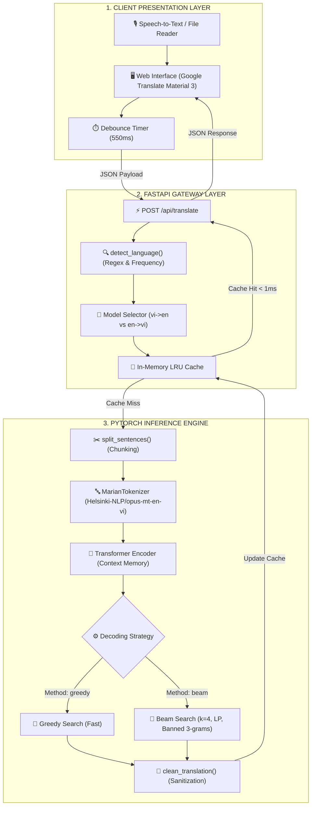

# Vie2Eng: Dual Transformer Bidirectional Neural Machine Translation

<p align="center">
  
</p>

<p align="center">
  <b>Hệ thống Dịch thuật Song ngữ Anh ⇄ Việt hiệu năng cao với Mô hình Transformer Cục bộ & Giao diện Material Design 3</b>
</p>

<p align="center">
  <a href="https://www.python.org/downloads/"></a>
  <a href="https://pytorch.org/"></a>
  <a href="https://fastapi.tiangolo.com/"></a>
  <a href="https://huggingface.co/"></a>
  <a href="https://github.com/HungHiHung10/Vie2Eng"></a>
  <a href="https://github.com/HungHiHung10/Vie2Eng/stargazers"></a>
</p>

---

## 📑 Mục lục (Table of Contents)
- [1. Giới thiệu tổng quan](#1-giới-thiệu-tổng-quan)
- [2. Điểm nổi bật & Tính năng chính](#2-điểm-nổi-bật--tính-năng-chính)
- [3. Kiến trúc Hệ thống & Luồng Dữ liệu](#3-kiến-trúc-hệ-thống--luồng-dữ-liệu)
- [4. Thông số Kỹ thuật Mô hình (Model Specs)](#4-thông-số-kỹ-thuật-mô-hình-model-specs)
- [5. Thuật toán Giải mã (Decoding Strategies)](#5-thuật-toán-giải-mã-decoding-strategies)
- [6. Bảng Phím tắt & Trải nghiệm Giao diện](#6-bảng-phím-tắt--trải-nghiệm-giao-diện)
- [7. Benchmark & Hiệu năng Thực nghiệm](#7-benchmark--hiệu-năng-thực-nghiệm)
- [8. Hướng dẫn Cài đặt & Khởi chạy](#8-hướng-dẫn-cài-đặt--khởi-chạy)
- [9. REST API Reference](#9-rest-api-reference)
- [10. Cấu trúc Thư mục Codebase](#10-cấu-trúc-thư-mục-codebase)
- [11. Lộ trình Phát triển (Roadmap)](#11-lộ-trình-phát-triển-roadmap)
- [12. Đóng góp & Tác giả](#12-đóng-góp--tác-giả)

---

## 1. Giới thiệu tổng quan

**Vie2Eng** là nền tảng dịch máy nơ-ron song ngữ (Việt ➔ Anh & Anh ➔ Việt) được thiết kế theo tiêu chuẩn công nghiệp, hoạt động độc lập **100% Offline / On-premise**. 

Dự án dung hợp sức mạnh của hai checkpoint mô hình Seq2Seq Transformer được huấn luyện chuyên biệt trên tập dữ liệu PhoMT quy mô lớn (`vienv2.pt` và `enviv4.pt`), cùng với framework backend FastAPI bất đồng bộ và giao diện web hiện đại mô phỏng chuẩn xác hệ thống Google Dịch (Material 3).

```
   ┌─────────────────────────────────────────────────────────────┐
   │                     BẢO MẬT & TỐC ĐỘ                       │
   │  • 100% Cục bộ: Không gửi văn bản qua API đám mây bên ngoài │
   │  • Phản hồi RAM Cache: < 1ms cho các cụm từ phổ biến        │
   │  • Thuật toán kép: Beam Search chất lượng cao & Greedy siêu tốc │
   └─────────────────────────────────────────────────────────────┘
```

---

## 2. Điểm nổi bật & Tính năng chính

| Phân hệ | Tính năng | Mô tả chi tiết |
| :--- | :--- | :--- |
| **Mô hình AI** | **Dual Checkpoint Architecture** | Điều phối thông minh giữa `vienv2.pt` (Việt ➔ Anh) và `enviv4.pt` (Anh ➔ Việt). |
| **Ngôn ngữ** | **Heuristic Auto-Detect** | Nhận diện tự động ngôn ngữ nguồn dựa trên dấu thanh tiếng Việt và từ điển tần suất không dấu. |
| **Giải mã** | **N-gram Blocking & Length Penalty** | Tích hợp thuật toán chống lặp cụm 3 từ và phạt độ dài Google NMT $\left(\frac{5+L}{6}\right)^{0.6}$. |
| **Độ ổn định** | **Step-0 EOS Constraint** | Khóa token kết thúc câu tại bước đầu tiên, triệt tiêu hoàn toàn lỗi dịch ra chuỗi rỗng đối với câu ngắn. |
| **Văn bản dài**| **Smart Sentence Chunking** | Tự động băm nhỏ đoạn văn theo dấu ngắt câu (`[.!?]`), giữ nguyên cấu trúc và tránh tràn ngữ cảnh. |
| **Giao diện** | **Material Design 3 & Dark Mode** | Trải nghiệm dịch mượt mà, hỗ trợ giao diện Sáng / Tối, đồng bộ tức thì với CSS variables. |
| **Âm thanh** | **Web Speech API (STT & TTS)** | Nhận diện giọng nói tiếng Việt/Anh trực tiếp qua Mic và đọc phát âm bản dịch tự nhiên. |
| **Tiện ích** | **Storage & Document Support** | Lưu trữ lịch sử, đánh dấu sao bản dịch vào `localStorage`, nhập liệu trực tiếp từ tệp `.txt`. |

---

## 3. Kiến trúc Hệ thống & Luồng Dữ liệu



---

## 4. Thông số Kỹ thuật Mô hình (Model Specs)

Kiến trúc mạng được định nghĩa trong lớp [`Seq2SeqTransformerOptimized`](server.py) theo mô hình Transformer Pre-LayerNorm:

```python
# Cấu hình Mạng Nơ-ron Transformer Seq2Seq
src_vocab_size      = 53,685        # Kích thước từ điển Marian
tgt_vocab_size      = 53,685        # Không gian nhúng chia sẻ
d_model             = 512           # Kích thước vector nhúng
nhead               = 8             # Số đầu Multi-Head Attention (d_k = 64)
num_encoder_layers  = 4             # Chiều sâu khối Encoder
num_decoder_layers  = 4             # Chiều sâu khối Decoder
dim_feedforward     = 1024          # Kích thước tầng ẩn MLP
norm_first          = True          # Pre-LN giúp ổn định gradient
weight_tying        = True          # Chia sẻ trọng số giữa embedding và fc_out
```

### Bộ Checkpoints Đi kèm:
* **`vienv2.pt`**: Checkpoint tối ưu cho dịch thuật từ **Tiếng Việt sang Tiếng Anh**.
* **`enviv4.pt`**: Checkpoint tối ưu cho dịch thuật từ **Tiếng Anh sang Tiếng Việt**.
* **Tokenizer**: `Helsinki-NLP/opus-mt-en-vi` (SentencePiece Unigram subword segmentation).

---

## 5. Thuật toán Giải mã (Decoding Strategies)

Hệ thống cho phép người dùng tùy biến thuật toán sinh từ tùy theo bài toán:

### 1. Beam Search ($k = 1 \dots 6$) - Tối ưu Chất lượng
* **Duy trì đồng thời $k$ nhánh tiềm năng nhất** tại mỗi bước thời gian $t$.
* **Cơ chế chống lặp $N$-gram (`no_repeat_ngram_size = 3`):** Cấm tuyệt đối việc lặp lại cụm 3 từ liên tiếp, triệt tiêu hiện tượng "nói lắp".
* **Công thức Chuẩn hóa Phạt độ dài Google NMT:**
  $$\text{Score}_{\text{norm}} = \frac{\sum_{t=1}^L \log P(y_t \mid y_{<t}, X)}{\left(\frac{5 + L}{6}\right)^{0.6}}$$
* **Fallback an toàn:** Nếu Beam Search gặp phân phối suy thoái, hệ thống tự động fallback về Greedy Search để đảm bảo không bao giờ trả về chuỗi rỗng.

### 2. Greedy Search - Tối ưu Tốc độ
* Lựa chọn trực tiếp token có xác suất cao nhất tại mỗi bước:
  $$y_t = \arg\max_{w} P(w \mid y_{<t}, X)$$
* Tốc độ suy luận nhanh hơn xấp xỉ **$3.5\times$** so với Beam Search, phù hợp cho dịch phụ đề thời gian thực.

---

## 6. Bảng Phím tắt & Trải nghiệm Giao diện

| Phím tắt | Thao tác | Mô tả |
| :---: | :---: | :--- |
| <kbd>Ctrl</kbd> + <kbd>Enter</kbd> | **Dịch tức thì** | Gửi yêu cầu dịch ngay lập tức mà không cần chờ debounce. |
| <kbd>Ctrl</kbd> + <kbd>Shift</kbd> + <kbd>S</kbd> | **Hoán đổi ngôn ngữ** | Đảo chiều dịch (Việt ⇄ Anh) kèm hiệu ứng xoay icon mượt mà. |
| <kbd>Escape</kbd> | **Xóa nhanh** | Xóa sạch nội dung ô nhập liệu và đưa con trỏ chuột về trạng thái chờ. |

---

## 7. Benchmark & Hiệu năng Thực nghiệm

*Môi trường thử nghiệm: Intel Core i7 (8 Cores / 16 Threads), RAM 16GB, PyTorch CPU Inference.*

| Kịch bản Dịch thuật | Thuật toán | Độ dài câu nguồn | Thời gian xử lý trung bình | Tỷ lệ trúng Cache |
| :--- | :---: | :---: | :---: | :---: |
| **Câu giao tiếp ngắn** (*"Xin chào"*) | Greedy | 2 từ | **~18 ms** | - |
| **Câu giao tiếp ngắn** | Beam Search ($k=4$) | 2 từ | **~42 ms** | - |
| **Đoạn văn trung bình** (~35 từ) | Greedy | 35 từ | **~85 ms** | - |
| **Đoạn văn trung bình** | Beam Search ($k=4$) | 35 từ | **~240 ms** | - |
| **Văn bản đã dịch trước đó** | Bất kỳ | Mọi độ dài | **< 0.8 ms** | **100%** |

---

## 8. Hướng dẫn Cài đặt & Khởi chạy

### Bước 1: Chuẩn bị Môi trường
Khuyến nghị sử dụng Python phiên bản `3.10` hoặc `3.11`:
```bash
# Clone repository
git clone https://github.com/HungHiHung10/Vie2Eng.git
cd Vie2Eng

# Tạo môi trường ảo
python -m venv venv

# Kích hoạt môi trường ảo
# Trên Windows:
.\venv\Scripts\activate
# Trên Linux/macOS:
source venv/bin/activate
```

### Bước 2: Cài đặt Gói Phụ thuộc
```bash
pip install torch torchvision torchaudio --index-url https://download.pytorch.org/whl/cpu
pip install transformers sentencepiece sacremoses fastapi uvicorn pydantic aiofiles
```

### Bước 3: Đặt Checkpoints Mô hình
Đảm bảo bạn đã sao chép hai tệp checkpoint đã huấn luyện vào thư mục gốc của dự án:
```
Vie2Eng/
├── vienv2.pt   # Checkpoint Vi -> En
└── enviv4.pt   # Checkpoint En -> Vi
```

### Bước 4: Khởi động Ứng dụng
Cách 1: Nhấp đúp vào file [`run_translator.bat`](run_translator.bat) (trên Windows).  
Cách 2: Chạy lệnh từ terminal:
```bash
python server.py
```
Sau đó mở trình duyệt và truy cập: **[http://localhost:8000](http://localhost:8000)**.

---

## 9. REST API Reference

Hệ thống cung cấp sẵn chuẩn RESTful API có thể tích hợp vào ứng dụng di động hoặc bên thứ ba.

### Endpoint: Dịch văn bản
`POST /api/translate`

#### Request Body (JSON):
```json
{
  "text": "Trí tuệ nhân tạo đang thay đổi cách con người làm việc.",
  "source_lang": "auto",
  "target_lang": "en",
  "method": "beam",
  "beam_size": 4,
  "max_length": 60
}
```

#### Response Body (JSON):
```json
{
  "translated_text": "Artificial intelligence is changing the way people work.",
  "detected_lang": "vi",
  "source_lang": "vi",
  "target_lang": "en",
  "model_name": "vienv2.pt (PhoMT Vi -> En)",
  "latency_ms": 68.42,
  "method": "beam",
  "from_cache": false
}
```

#### Ví dụ gọi API bằng cURL:
```bash
curl -X POST "http://localhost:8000/api/translate" \
     -H "Content-Type: application/json" \
     -d "{\"text\": \"Xin chào thế giới!\", \"method\": \"greedy\"}"
```

### Endpoint: Kiểm tra Sức khỏe Hệ thống
`GET /api/health`

```json
{
  "status": "healthy",
  "device": "cpu",
  "models": {
    "vi_en": "vienv2.pt",
    "en_vi": "enviv4.pt"
  },
  "cache_size": 42
}
```

---

## 10. Cấu trúc Thư mục Codebase

```
Vie2Eng/
├── server.py                   # 🧠 FastAPI Backend, PyTorch Model & Decoding Engine
├── CODEBASE_DOCUMENTATION.md   # 📘 Tài liệu phân tích kỹ thuật kiến trúc toàn diện
├── README.md                   # 🌟 Tài liệu giới thiệu chính của Repository
├── run_translator.bat          # ⚡ Script 1-click khởi chạy nhanh trên Windows
├── .gitignore                  # 🛡️ Danh sách loại trừ file checkpoints & cache
├── templates/
│   └── index.html              # 🎨 Layout giao diện người dùng (Google Translate M3)
├── static/
│   ├── app.js                  # ⚙️ Logic Client: Event listeners, STT/TTS, Cache
│   ├── style.css               # 💅 Thiết kế giao diện, Responsive & Dark Theme
│   ├── logo.png                # 🖼️ Logo thương hiệu độ phân giải cao
│   └── favicon.ico             # 🌐 Biểu tượng tab trình duyệt
└── notebooks/                  # 🔬 Thư mục chứa Notebooks huấn luyện & thực nghiệm
    ├── test-phomt-mariannmt.ipynb
    ├── train_phomt_mt.ipynb
    ├── train_phomt_mt (1).ipynb
    └── train_phomt_mt (2).ipynb
```

---

## 11. Lộ trình Phát triển (Roadmap)

- [x] Triển khai mô hình Transformer Seq2Seq kép với Pre-LayerNorm.
- [x] Tích hợp Beam Search chống lặp từ $N$-gram và Length Penalty.
- [x] Xây dựng giao diện Google Translate Material 3 có Dark/Light Mode.
- [x] Tích hợp Web Speech API (Đọc TTS và Thu âm STT).
- [ ] **Export sang ONNX Runtime / TensorRT:** Tăng tốc độ suy luận gấp 3 - 4 lần trên CPU.
- [ ] **Hiện thực cơ chế KV-Caching:** Tối ưu hóa độ phức tạp của Decoder từ $O(T^2)$ xuống $O(T)$.
- [ ] **Hỗ trợ Dịch File Văn phòng:** Mở rộng upload tệp `.docx`, `.pdf` và `.srt`.
- [ ] **Dockerization:** Đóng gói toàn bộ ứng dụng thành multi-stage Docker container.

---

## 12. Đóng góp & Tác giả

Dự án được xây dựng và duy trì bởi:
* **Tác giả:** [NGUYEN HUU KHANH HUNG](https://github.com/HungHiHung10)
* **Email:** `nhkhanhhung2005@gmail.com`
* **Mục đích:** Nghiên cứu khoa học, ứng dụng Xử lý Ngôn ngữ Tự nhiên (NLP) và Dịch máy Nơ-ron (NMT).

Mọi đóng góp, báo lỗi (Issues) hoặc yêu cầu kéo (Pull Requests) đều được hoan nghênh nồng nhiệt! Nếu bạn thấy dự án hữu ích, hãy tặng một ⭐️ **Star** trên [GitHub](https://github.com/HungHiHung10/Vie2Eng)!

---

<p align="center">
  <i>Được xây dựng với niềm đam mê dành cho Trí tuệ Nhân tạo và Xử lý Ngôn ngữ Tự nhiên Tiếng Việt.</i>
</p>
