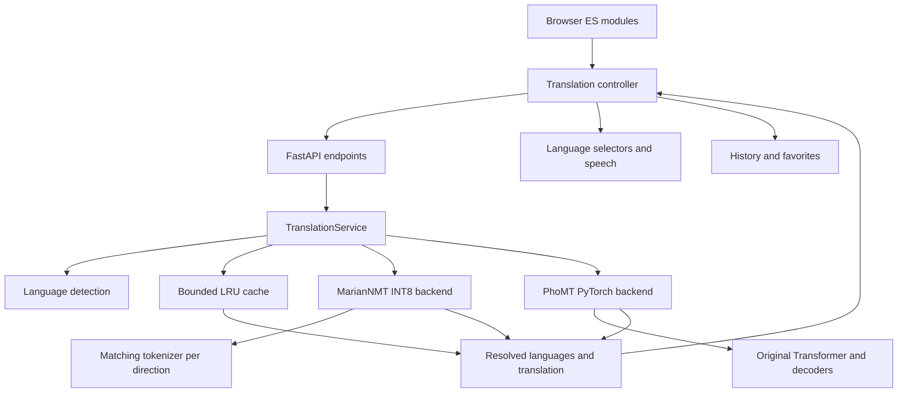

# Vie2Eng: Dual Transformer Bidirectional Neural Machine Translation

<p align="center">
  
</p>

<p align="center">
  <b>Hệ thống Dịch thuật Song ngữ Anh - Việt hiệu năng cao ứng dụng Mô hình Transformer Cục bộ và Giao diện Material Design 3</b>
</p>

<p align="center">
  <a href="https://www.python.org/downloads/"></a>
  <a href="https://pytorch.org/"></a>
  <a href="https://fastapi.tiangolo.com/"></a>
  <a href="https://huggingface.co/"></a>
  <a href="https://github.com/HungHiHung10/Vie2Eng"></a>
  <a href="https://github.com/HungHiHung10/Vie2Eng"></a>
</p>

---

## Mục lục (Table of Contents)
- [1. Giới thiệu tổng quan](#1-giới-thiệu-tổng-quan)
- [2. Điểm nổi bật & Tính năng chính](#2-điểm-nổi-bật--tính-năng-chính)
- [3. Kiến trúc Hệ thống & Luồng Dữ liệu](#3-kiến-trúc-hệ-thống--luồng-dữ-liệu)
- [4. Thông số Kỹ thuật Mô hình (Model Specifications)](#4-thông-số-kỹ-thuật-mô-hình-model-specifications)
- [5. Thuật toán Giải mã (Decoding Strategies)](#5-thuật-toán-giải-mã-decoding-strategies)
- [6. Bảng Phím tắt & Trải nghiệm Người dùng](#6-bảng-phím-tắt--trải-nghiệm-người-dùng)
- [7. Đánh giá Hiệu năng Thực nghiệm (Benchmarks)](#7-đánh-giá-hiệu-năng-thực-nghiệm-benchmarks)
- [8. Hướng dẫn Cài đặt & Khởi chạy](#8-hướng-dẫn-cài-đặt--khởi-chạy)
- [9. Đặc tả REST API (API Reference)](#9-đặc-tả-rest-api-api-reference)
- [10. Cấu trúc Thư mục Dự án](#10-cấu-trúc-thư-mục-dự-án)
- [11. Lộ trình Phát triển (Roadmap)](#11-lộ-trình-phát-triển-roadmap)
- [12. Thông tin Tác giả & Bản quyền](#12-thông-tin-tác-giả--bản-quyền)

---

## 1. Giới thiệu tổng quan

**Vie2Eng** là nền tảng dịch máy nơ-ron song ngữ (Việt ➔ Anh và Anh ➔ Việt) được xây dựng theo kiến trúc hướng dịch vụ, hỗ trợ suy luận cục bộ (**Offline / On-premise**) sau khi tải model và tokenizer.

Hệ thống tích hợp hai checkpoint mô hình Seq2Seq Transformer được huấn luyện chuyên biệt trên tập ngữ liệu PhoMT (`vienv2.pt` và `enviv4.pt`), kết hợp cùng tầng backend FastAPI bất đồng bộ và giao diện web chuẩn Material Design 3 mô phỏng trải nghiệm Google Dịch.

Ứng dụng bổ sung hai model **MarianNMT CTranslate2 INT8**, được chọn mặc định:

| Chiều dịch | Model | Tokenizer gốc |
| :--- | :--- | :--- |
| Việt → Anh | [MarianNMT-vi2en-ct2-int8](https://huggingface.co/HungNguyen29/MarianNMT-vi2en-ct2-int8) | `HungNguyen29/MarianNMT-PhoMT_vi2en` |
| Anh → Việt | [MarianNMT-en2vi-ct2-int8](https://huggingface.co/HungNguyen29/MarianNMT-en2vi-ct2-int8) | `HungNguyen29/MarianNMT-PhoMT_en2vi` |

Trong **Cài đặt → Mô hình dịch**, chọn `MarianNMT INT8 (mới)` hoặc `PhoMT Transformer (.pt)`. Ứng dụng tự chọn chiều dịch và ghi nhớ lựa chọn trên trình duyệt. Model chỉ được nạp vào RAM khi dùng lần đầu. CTranslate2 chạy trên CPU với `compute_type="int8"`; các checkpoint `.pt` vẫn dùng thiết bị PyTorch hiện có.

### Nguyên tắc Thiết kế Cốt lõi
* **Bảo mật Dữ liệu Tuyệt đối:** Toàn bộ quá trình mã hóa ngữ cảnh và giải mã được thực thi cục bộ trên RAM/CPU nội bộ, không phát sinh bất kỳ yêu cầu truyền dữ liệu ra Internet.
* **Tối ưu hóa Truy vấn Lặp lại:** Bộ đệm LRU trong RAM tái sử dụng kết quả của cùng model, chiều dịch và cấu hình giải mã, giúp tránh chạy lại suy luận cho yêu cầu đã xử lý.
* **Tính Linh hoạt Cao:** Cho phép người dùng chuyển đổi linh hoạt giữa thuật toán Beam Search (tối ưu hóa độ chính xác ngữ nghĩa) và Greedy Search (tối ưu hóa tốc độ xử lý).

---

## 2. Điểm nổi bật & Tính năng chính

| Hạng mục | Tính năng | Chi tiết kỹ thuật |
| :--- | :--- | :--- |
| **Kiến trúc AI** | **Dual Checkpoint Routing** | Cơ chế điều phối tự động giữa `vienv2.pt` (Việt ➔ Anh) và `enviv4.pt` (Anh ➔ Việt). |
| **Tiền xử lý** | **Heuristic Language Detection** | Nhận diện tự động ngôn ngữ nguồn dựa trên phân tích tập ký tự có dấu thanh và đối sánh tần suất từ vựng không dấu. |
| **Giải mã** | **N-gram Blocking & Length Penalty** | Tích hợp cơ chế cấm lặp cụm 3 từ liên tiếp và chuẩn hóa điểm số theo độ dài Google NMT $\left(\frac{5+L}{6}\right)^{0.6}$. |
| **Độ ổn định** | **Step-0 EOS Constraint** | Chặn token kết thúc câu tại bước đầu tiên ($step = 0$), giải quyết triệt để lỗi sinh ra chuỗi rỗng đối với các câu giao tiếp ngắn. |
| **Văn bản dài** | **Sentence Chunking** | Tự động băm nhỏ văn bản theo ranh giới câu (`[.!?]`), đảm bảo không vượt quá độ dài ngữ cảnh tối đa của mạng Transformer. |
| **Giao diện Web** | **Material Design 3 & Dark Mode** | Thiết kế giao diện tương thích chuẩn Google Dịch, hỗ trợ chuyển đổi chủ đề Sáng / Tối thông qua biến số CSS. |
| **Đa phương thức** | **Web Speech API (STT & TTS)** | Hỗ trợ nhận diện giọng nói tiếng Việt/Anh trực tiếp qua Microphone và bộ đọc phát âm tổng hợp văn bản. |
| **Tiện ích** | **Storage & Document Support** | Quản lý lịch sử dịch, đánh dấu bản dịch yêu thích thông qua `localStorage`, hỗ trợ nạp văn bản từ tệp `.txt`. |

---

## 3. Kiến trúc Hệ thống & Luồng Dữ liệu



---

## 4. Thông số Kỹ thuật Mô hình (Model Specifications)

Kiến trúc checkpoint PyTorch được định nghĩa trong lớp [`Seq2SeqTransformerOptimized`](vie2eng/backends/transformer.py) theo mô hình Transformer Pre-LayerNorm (Norm-First):

```python
# Cấu hình Mạng Nơ-ron Transformer Seq2Seq
src_vocab_size      = 53,685        # Kích thước từ điển Marian
tgt_vocab_size      = 53,685        # Không gian nhúng chia sẻ
d_model             = 512           # Kích thước vector nhúng
nhead               = 8             # Số đầu Multi-Head Attention (d_k = 64)
num_encoder_layers  = 4             # Chiều sâu khối Encoder
num_decoder_layers  = 4             # Chiều sâu khối Decoder
dim_feedforward     = 1024          # Kích thước tầng ẩn MLP
norm_first          = True          # Pre-LN giúp ổn định gradient
weight_tying        = True          # Chia sẻ trọng số giữa embedding và fc_out
```

### Chi tiết Checkpoint
* **`vienv2.pt`**: Checkpoint huấn luyện cho chiều dịch **Tiếng Việt ➔ Tiếng Anh**.
* **`enviv4.pt`**: Checkpoint huấn luyện cho chiều dịch **Tiếng Anh ➔ Tiếng Việt**.
* **Bộ Tokenizer**: `Helsinki-NLP/opus-mt-en-vi` (Kỹ thuật phân đoạn từ con SentencePiece Unigram).

---

## 5. Thuật toán Giải mã (Decoding Strategies)

Hệ thống hỗ trợ cấu hình linh hoạt hai thuật toán giải mã tự hồi quy:

### 1. Beam Search ($k = 1 \dots 6$) - Tối ưu Độ chính xác
* Duy trì song song $k$ giả thuyết có xác suất tích lũy cao nhất tại mỗi bước thời gian $t$.
* **Cơ chế chống lặp từ (`no_repeat_ngram_size = 3`):** Quét lịch sử sinh từ; cấm sinh token nếu nó tạo thành cụm 3 từ đã xuất hiện trước đó trong câu.
* **Chuẩn hóa Độ dài theo Chuẩn Google NMT:**
  $$\text{Score}_{\text{norm}} = \frac{\sum_{t=1}^L \log P(y_t \mid y_{<t}, X)}{\left(\frac{5 + L}{6}\right)^{0.6}}$$
* **Cơ chế Dự phòng (Fallback):** Trong trường hợp Beam Search không sinh ra token hợp lệ, hệ thống tự động fallback sang Greedy Search nhằm đảm bảo tính sẵn sàng của bản dịch.

### 2. Greedy Search - Tối ưu Độ trễ
* Lựa chọn trực tiếp token có phân phối xác suất cực đại tại mỗi bước thời gian:
  $$y_t = \arg\max_{w} P(w \mid y_{<t}, X)$$
* Trong các lần đo được trình bày ở mục 7, tổng thời gian của Beam Search (`beams=4`) bằng **2.14–6.27 lần** Greedy Search, tùy model và chiều dịch. Đây là tỷ lệ của các lần chạy benchmark được báo cáo; tốc độ thực tế còn phụ thuộc môi trường và cấu hình suy luận.

---

## 6. Bảng Phím tắt & Trải nghiệm Người dùng

| Tổ hợp phím | Thao tác | Chức năng |
| :---: | :---: | :--- |
| <kbd>Ctrl</kbd> + <kbd>Enter</kbd> | Dịch tức thì | Thực thi yêu cầu dịch ngay lập tức, bỏ qua thời gian chờ của bộ đếm debounce. |
| <kbd>Ctrl</kbd> + <kbd>Shift</kbd> + <kbd>S</kbd> | Hoán đổi ngôn ngữ | Đảo chiều cặp ngôn ngữ (Việt ⇄ Anh) và đồng bộ lại văn bản giữa hai khung. |
| <kbd>Escape</kbd> | Xóa nội dung | Xóa toàn bộ văn bản trong ô nguồn và trả con trỏ chuột về trạng thái nhập. |

---

## 7. Đánh giá Hiệu năng Thực nghiệm (Benchmarks)

Phần này tổng hợp kết quả đánh giá được tác giả cung cấp cho ba nhóm: **MarianMT gốc của Helsinki-NLP**, **MarianNMT tinh chỉnh trên PhoMT** và **MarianNMT lượng tử hóa INT8**. Các bảng giữ nguyên điểm số, thời gian và tốc độ đã báo cáo; các mức chênh lệch được tính trực tiếp từ những số liệu đó.

**Kết quả nổi bật:** model tinh chỉnh đạt **39.62 SacreBLEU** cho Anh → Việt và **34.88 SacreBLEU** cho Việt → Anh với Beam Search (`beams=4`). Các bản INT8 tương ứng đạt **39.56** và **34.06 SacreBLEU** với cùng tên chiến lược giải mã. Chênh lệch chất lượng cần được đọc cùng điều kiện đánh giá ở bên dưới.

### 7.1. Phạm vi đánh giá và cách đọc chỉ số

| Hạng mục | Nội dung |
| :--- | :--- |
| **Chiều dịch** | Anh → Việt (`en2vi`) và Việt → Anh (`vi2en`). |
| **Tập đánh giá** | Split `test` của PhoMT trong các bảng baseline và model tinh chỉnh. |
| **Số mẫu** | **19,151 mẫu cho mỗi lần chạy** baseline hoặc model tinh chỉnh; không cộng hai chiều thành số mẫu duy nhất. |
| **Chiến lược giải mã** | Greedy Search (`num_beams=1`) và Beam Search (`num_beams=4`). |
| **Chất lượng dịch** | SacreBLEU, tương ứng cột `bleu` trong bảng kết quả; điểm cao hơn tốt hơn theo thước đo này. |
| **Thời gian** | Tổng thời gian chạy đánh giá, tính bằng giây; thống nhất hai tên cột đầu vào `time_second` và `time_sec` thành **Thời gian (s)**. |
| **Thông lượng** | Số mẫu xử lý mỗi giây (`speed_samples_per_sec`); giá trị cao hơn tương ứng thông lượng lớn hơn. |
| **Dữ liệu INT8** | Có điểm SacreBLEU; chưa kèm số mẫu, thời gian, thông lượng và cấu hình chạy chi tiết trong kết quả được cung cấp. |

Thông lượng được xác định theo công thức:

$$
\text{Thông lượng (mẫu/s)} = \frac{\text{Số mẫu đánh giá}}{\text{Tổng thời gian (s)}}
$$

Các số trong bảng được làm tròn đến hai chữ số thập phân. **Thông lượng đánh giá theo lô không tương đương độ trễ của một yêu cầu trên giao diện web**; không sử dụng trực tiếp các giá trị này để cam kết thời gian phản hồi của API.

### 7.2. Baseline: MarianMT gốc của Helsinki-NLP

Mỗi hàng dưới đây là một lần chạy trên split `test`, gồm **19,151 mẫu**.

| Model | Chiều dịch | Chiến lược | SacreBLEU ↑ | Thời gian (s) ↓ | Thông lượng (mẫu/s) ↑ |
| :--- | :---: | :--- | ---: | ---: | ---: |
| `Helsinki-NLP/opus-mt-en-vi` | Anh → Việt | Greedy Search | 25.94 | 192.82 | 99.32 |
| `Helsinki-NLP/opus-mt-en-vi` | Anh → Việt | Beam Search (`beams=4`) | **27.35** | 452.44 | 42.33 |
| `Helsinki-NLP/opus-mt-vi-en` | Việt → Anh | Greedy Search | 28.29 | 159.81 | 119.84 |
| `Helsinki-NLP/opus-mt-vi-en` | Việt → Anh | Beam Search (`beams=4`) | **29.01** | 367.06 | 52.17 |

Với model gốc, Beam Search tăng **1.41 điểm** ở chiều Anh → Việt và **0.72 điểm** ở chiều Việt → Anh so với Greedy Search. Đổi lại, thời gian đánh giá tăng lần lượt khoảng **2.35 lần** và **2.30 lần** trong các lần đo này.

### 7.3. MarianNMT tinh chỉnh trên PhoMT

Mỗi hàng dưới đây cũng sử dụng split `test`, gồm **19,151 mẫu**.

| Model / nguồn trọng số | Chiều dịch | Chiến lược | SacreBLEU ↑ | Thời gian (s) ↓ | Thông lượng (mẫu/s) ↑ |
| :--- | :---: | :--- | ---: | ---: | ---: |
| MarianNMT PhoMT — checkpoint Kaggle¹ | Anh → Việt | Greedy Search | 38.94 | 2629.14 | 7.28 |
| MarianNMT PhoMT — checkpoint Kaggle¹ | Anh → Việt | Beam Search (`beams=4`) | **39.62** | 16477.38 | 1.16 |
| `HungNguyen29/MarianNMT-PhoMT_vi2en`² | Việt → Anh | Greedy Search | 34.13 | 165.50 | 115.71 |
| `HungNguyen29/MarianNMT-PhoMT_vi2en`² | Việt → Anh | Beam Search (`beams=4`) | **34.88** | 353.49 | 54.18 |

¹ Bảng Anh → Việt ban đầu hiển thị rút gọn cột `model` thành `/kaggle/input/notebooks/khnhhngnguynhu/finetun...` và cột `checkpoint` thành `/kaggle/input/models/khnhhngnguynhu/phomt-mari...`. Vì chưa có định danh trọng số đầy đủ trong bảng này, kết quả được ghi theo nguồn Kaggle; không tự gán chúng cho một revision Hugging Face hoặc checkpoint `.pt` cụ thể đang dùng trong ứng dụng.

² Cột `checkpoint` của kết quả Việt → Anh là `hf_base`: trong [notebook đánh giá](notebooks/eval-phomt-mariannmt.ipynb), giá trị này có nghĩa là **dùng trực tiếp trọng số từ repository đã chỉ định, không nạp thêm checkpoint bên ngoài**. Repository được chỉ định ở đây là model đã tinh chỉnh `HungNguyen29/MarianNMT-PhoMT_vi2en`; `hf_base` không có nghĩa là quay về baseline Helsinki-NLP.

**Mức thay đổi so với baseline cùng chiều và chiến lược:**

| Chiều dịch | Chiến lược | Baseline | Sau tinh chỉnh | Δ SacreBLEU |
| :--- | :--- | ---: | ---: | ---: |
| Anh → Việt | Greedy Search | 25.94 | 38.94 | **+13.00** |
| Anh → Việt | Beam Search (`beams=4`) | 27.35 | 39.62 | **+12.27** |
| Việt → Anh | Greedy Search | 28.29 | 34.13 | **+5.84** |
| Việt → Anh | Beam Search (`beams=4`) | 29.01 | 34.88 | **+5.87** |

Các kết quả được báo cáo cho thấy điểm số sau tinh chỉnh cao hơn baseline ở cả hai chiều và cả hai chiến lược. Các giá trị Δ là **chênh lệch điểm tuyệt đối**, không phải phần trăm tăng chất lượng dịch. Việc quy mức tăng hoàn toàn cho quá trình tinh chỉnh cần bảo đảm các lần chạy dùng cùng tập tham chiếu và cấu hình chấm điểm.

### 7.4. Ảnh hưởng của lượng tử hóa INT8

Các model INT8 được tích hợp trong ứng dụng:

- Anh → Việt: [`HungNguyen29/MarianNMT-en2vi-ct2-int8`](https://huggingface.co/HungNguyen29/MarianNMT-en2vi-ct2-int8).
- Việt → Anh: [`HungNguyen29/MarianNMT-vi2en-ct2-int8`](https://huggingface.co/HungNguyen29/MarianNMT-vi2en-ct2-int8).

Trong bảng dưới, **Δ = điểm INT8 − điểm model tinh chỉnh trước lượng tử hóa**. Cặp điểm **33.95 / 34.06** được xác nhận thuộc chiều **Việt → Anh**.

| Chiều dịch | Chiến lược | Trước lượng tử hóa | INT8 | Δ SacreBLEU |
| :--- | :--- | ---: | ---: | ---: |
| Anh → Việt | Greedy Search | 38.94 | **39.02** | **+0.08** |
| Anh → Việt | Beam Search (`beams=4`) | **39.62** | 39.56 | **−0.06** |
| Việt → Anh | Greedy Search | **34.13** | 33.95 | **−0.18** |
| Việt → Anh | Beam Search (`beams=4`) | **34.88** | 34.06 | **−0.82** |

Ở chiều Anh → Việt, các điểm INT8 được báo cáo gần với model trước lượng tử hóa: tăng **0.08 điểm** với Greedy và giảm **0.06 điểm** với Beam. Chênh lệch nhỏ này chưa đủ để kết luận INT8 cải thiện chất lượng nếu chưa kiểm tra ý nghĩa thống kê và tính đồng nhất của quy trình đánh giá.

Ở chiều Việt → Anh, mức giảm là **0.18 điểm** với Greedy và **0.82 điểm** với Beam. Beam vẫn cao hơn Greedy trên bản INT8 (**34.06 so với 33.95**), nhưng mức tăng chỉ còn **0.11 điểm**, so với **0.75 điểm** ở bản trước lượng tử hóa.

**Chưa có số đo thời gian, RAM, kích thước model hoặc thông lượng INT8 trong dữ liệu đầu vào.** Vì vậy, phần này chỉ đối chiếu điểm SacreBLEU; chưa đưa ra hệ số tăng tốc hay mức tiết kiệm tài nguyên thực nghiệm của INT8. Để xác định riêng tác động của lượng tử hóa, cần đánh giá hai phiên bản từ cùng checkpoint với cùng dữ liệu và tham số giải mã.

### 7.5. Đánh đổi giữa Greedy Search và Beam Search

| Nhóm model | Chiều dịch | Δ SacreBLEU khi dùng Beam thay Greedy | Thời gian Beam / Greedy |
| :--- | :--- | ---: | ---: |
| Helsinki-NLP gốc | Anh → Việt | +1.41 | 2.35× |
| Helsinki-NLP gốc | Việt → Anh | +0.72 | 2.30× |
| MarianNMT tinh chỉnh | Anh → Việt | +0.68 | 6.27× |
| MarianNMT tinh chỉnh | Việt → Anh | +0.75 | 2.14× |
| MarianNMT INT8 | Anh → Việt | +0.54 | Chưa có số đo |
| MarianNMT INT8 | Việt → Anh | +0.11 | Chưa có số đo |

Beam Search đạt điểm cao hơn Greedy trong cả sáu cặp kết quả được cung cấp. Riêng model tinh chỉnh Anh → Việt, mức tăng **0.68 điểm** đi kèm tổng thời gian tăng từ **2629.14 s** lên **16477.38 s**; đây là đánh đổi đáng cân nhắc khi chọn cấu hình vận hành. Các tỷ lệ thời gian trên mô tả những lần chạy đã báo cáo, không phải hệ số cố định của thuật toán.

### 7.6. Điều kiện so sánh và khả năng tái lập

Kết quả trên là số liệu thực nghiệm được tác giả cung cấp, **chưa được chạy lại trên toàn bộ tập test trong lần cập nhật tài liệu này**. Những thông tin chưa có trong bảng đầu vào gồm phần cứng thực tế, phiên bản thư viện, revision trọng số, precision của bản trước lượng tử hóa và chữ ký SacreBLEU của từng lần chạy.

[Notebook đánh giá hiện có](notebooks/eval-phomt-mariannmt.ipynb) sử dụng `evaluate.load("sacrebleu")`, cấu hình `batch_size=64`, `max_length=128` ở vòng gọi thí nghiệm và đo thời gian vòng suy luận kèm giải mã/xử lý kết quả. Thời gian này không bao gồm bước nạp model ban đầu và phép tính SacreBLEU sau vòng lặp. Đây là cấu hình tham khảo trong mã nguồn; không tự xem là cấu hình đã được xác nhận cho mọi hàng, đặc biệt là INT8.

Để công bố một phép so sánh có thể tái lập, mỗi lần chạy nên lưu kèm:

- Model/revision và đường dẫn checkpoint đầy đủ; tập test/tham chiếu cùng phiên bản, bảo đảm không trùng dữ liệu huấn luyện.
- CPU/GPU, RAM/VRAM, số luồng, runtime và phiên bản thư viện; precision hoặc cấu hình lượng tử hóa.
- Batch size, tokenizer, giới hạn độ dài, số beam, length penalty và các tham số chống lặp/dừng sinh.
- Phiên bản và chữ ký SacreBLEU, cách chuẩn hóa văn bản; phạm vi bấm giờ, warm-up và số lần đo lặp.

Khi chạy lại notebook, cần truyền `checkpoint_path` tường minh cho từng thí nghiệm và kiểm tra log nạp trọng số: cấu hình mặc định hiện trỏ đến checkpoint Việt → Anh. Các so sánh chất lượng cần thống nhất dữ liệu và cách chấm; các so sánh tốc độ còn cần thống nhất phần cứng, runtime và cấu hình suy luận.

---

## 8. Hướng dẫn Cài đặt & Khởi chạy

### Bước 1: Chuẩn bị Môi trường
Khuyến nghị sử dụng Python phiên bản `3.10` hoặc `3.11`:
```bash
# Clone mã nguồn
git clone https://github.com/HungHiHung10/Vie2Eng.git
cd Vie2Eng

# Tạo môi trường ảo
python -m venv venv

# Kích hoạt môi trường ảo
# Windows:
.\venv\Scripts\activate
# Linux / macOS:
source venv/bin/activate
```

### Bước 2: Cài đặt Thư viện Phụ thuộc
```bash
pip install torch torchvision torchaudio --index-url https://download.pytorch.org/whl/cpu
pip install -r requirements.txt
```

### Bước 3: Chuẩn bị Mô hình

Tải hai model INT8 và tokenizer trước khi chạy offline:

```bash
python download_models.py
```

Hai repository INT8 không chứa tokenizer; script tải tokenizer từ repository PhoMT tương ứng và kiểm tra từ vựng trước khi nạp. Phiên bản model và tokenizer được cố định trong `vie2eng/config.py`. Tệp tải được lưu trong `models/` (được Git bỏ qua), có thể đổi bằng biến môi trường `VIE2ENG_MODEL_CACHE`. Cần Internet cho lần tải đầu; sau đó dịch văn bản bằng tài nguyên cục bộ.

Nếu cần xác thực Hugging Face, đặt biến môi trường `HF_TOKEN` trong phiên terminal trước khi chạy script. Không ghi token vào mã nguồn hay frontend. Các repository công khai có thể tải không cần token.

Để dùng lựa chọn PhoMT Transformer cũ, sao chép hai tệp checkpoint đã huấn luyện vào thư mục gốc của dự án:
```
Vie2Eng/
├── vienv2.pt   # Trọng số mô hình Việt -> Anh
└── enviv4.pt   # Trọng số mô hình Anh -> Việt
```

### Bước 4: Khởi động Ứng dụng
Khởi chạy thông qua script batch trên Windows:
```bash
run_translator.bat
```
Hoặc thực thi trực tiếp qua terminal:
```bash
python server.py
```
Sau đó mở trình duyệt và truy cập: **[http://localhost:8000](http://localhost:8000)**.

---

## 9. Đặc tả REST API (API Reference)

### Endpoint: Dịch thuật
`POST /api/translate`

#### Cấu trúc Request Body (JSON):
```json
{
  "text": "Trí tuệ nhân tạo đang thay đổi cách con người làm việc.",
  "source_lang": "auto",
  "target_lang": "en",
  "model_backend": "marian_ct2",
  "method": "beam",
  "beam_size": 4,
  "max_length": 60
}
```

#### Cấu trúc Response Body (JSON):
```json
{
  "translated_text": "Artificial intelligence is changing the way people work.",
  "detected_lang": "vi",
  "source_lang": "vi",
  "target_lang": "en",
  "model_name": "HungNguyen29/MarianNMT-vi2en-ct2-int8",
  "latency_ms": 68.42,
  "method": "beam",
  "from_cache": false
}
```

#### Ví dụ Thực thi qua cURL:

`model_backend`: `marian_ct2` (mặc định) hoặc `legacy` (checkpoint `.pt`). `method`: `beam` hoặc `greedy`; `beam_size`: 1–6; `max_length`: 2–128 token. Beam size 1 tương đương Greedy. Bộ đệm phân biệt model, chiều dịch, phương pháp và độ dài tối đa.

Nếu chưa tải được model, API trả HTTP 503 kèm hướng dẫn chuẩn bị model; `/api/health` kiểm tra máy chủ, không kích hoạt tải model.

```bash
curl -X POST "http://localhost:8000/api/translate" \
     -H "Content-Type: application/json" \
     -d "{\"text\": \"Xin chào thế giới!\", \"method\": \"greedy\"}"
```

### Endpoint: Giám sát Trạng thái
`GET /api/health`

```json
{
  "status": "healthy",
  "device": "cpu",
  "models": {
    "vi_en": "HungNguyen29/MarianNMT-vi2en-ct2-int8",
    "en_vi": "HungNguyen29/MarianNMT-en2vi-ct2-int8"
  },
  "default_backend": "marian_ct2",
  "ct2_device": "cpu",
  "legacy_models": {"vi_en": "vienv2.pt", "en_vi": "enviv4.pt"},
  "cache_size": 42
}
```

---

## 10. Cấu trúc Thư mục Dự án

```
Vie2Eng/
├── server.py                   # Điểm khởi chạy FastAPI/Uvicorn
├── download_models.py          # Chuẩn bị model INT8 và tokenizer
├── requirements.txt            # Thư viện chạy ứng dụng
├── requirements-dev.txt        # Thêm thư viện kiểm thử HTTP
├── vie2eng/
│   ├── api.py                  # Tạo ứng dụng, endpoint, phiên bản tài nguyên web
│   ├── service.py              # Điều phối dịch và chọn model
│   ├── schemas.py              # Kiểm tra request/response
│   ├── language.py             # Nhận diện ngôn ngữ
│   ├── config.py               # Đường dẫn, model và phiên bản tokenizer
│   ├── cache.py                # LRU cache giới hạn dung lượng, an toàn đa luồng
│   └── backends/
│       ├── ct2.py              # Suy luận MarianNMT INT8
│       ├── legacy.py           # Nạp checkpoint, giải mã Beam/Greedy
│       └── transformer.py      # Kiến trúc checkpoint PyTorch
├── templates/
│   └── index.html
├── static/
│   ├── app.js                  # Ghép mô-đun và gắn sự kiện giao diện
│   ├── js/                     # DOM, trạng thái, ngôn ngữ, API, cài đặt, lịch sử, âm thanh
│   └── style.css
├── tests/                      # Kiểm thử API, suy luận và trạng thái giao diện
├── models/                     # Model tải về, không đưa vào Git
└── notebooks/                  # Huấn luyện và đánh giá mô hình
```

Frontend dùng ES modules trực tiếp, không cần bước build. Ngôn ngữ được đồng bộ qua `static/js/languages.js`; thời gian chờ và thứ tự phản hồi API được quản lý trong `static/js/translation.js`. Mỗi lần cập nhật mã JavaScript, trang tự đổi mã phiên bản tài nguyên và yêu cầu trình duyệt kiểm tra lại cache.

### Kiểm thử sau khi sửa mã

```bash
pip install -r requirements-dev.txt
python -m unittest discover -s tests -v
node --experimental-vm-modules tests/test_client.cjs
```

Kiểm thử giao diện dùng bộ mô phỏng DOM và mô-đun JavaScript của Node.js, không điều khiển trình duyệt thật. Để kiểm tra cả model đã tải và checkpoint cũ trong PowerShell:

```powershell
$env:HF_HUB_OFFLINE = "1"
$env:VIE2ENG_TEST_MODELS = "1"
python -m unittest discover -s tests -v
```

Xem [tài liệu cấu trúc và luồng xử lý](CODEBASE_DOCUMENTATION.md) để biết nơi chỉnh sửa từng chức năng.

---

## 11. Lộ trình Phát triển (Roadmap)

- [x] Triển khai kiến trúc Transformer Seq2Seq kép với cơ chế Pre-LayerNorm.
- [x] Hiện thực thuật toán Beam Search chống lặp từ và chuẩn hóa độ dài Google NMT.
- [x] Xây dựng giao diện web mô phỏng Google Translate với Material 3 và Dark Mode.
- [x] Tích hợp bộ công cụ Web Speech API (nhận diện giọng nói và phát âm).
- [ ] Chuyển đổi mô hình sang ONNX Runtime / TensorRT để tăng tốc độ suy luận trên CPU.
- [ ] Hiện thực cơ chế KV-Caching cho Decoder nhằm tối ưu hóa độ phức tạp tính toán từ $O(T^2)$ xuống $O(T)$.
- [ ] Mở rộng tính năng trích xuất và dịch tài liệu văn phòng định dạng `.docx` và `.pdf`.
- [ ] Xây dựng Dockerfile chuẩn hóa hỗ trợ triển khai containerized.

---

## 12. Thông tin Tác giả & Bản quyền

* **Tác giả:** [NGUYEN HUU KHANH HUNG](https://github.com/HungHiHung10)
* **Email liên hệ:** `nhkhanhhung2005@gmail.com`
* **Mục tiêu nghiên cứu:** Xử lý Ngôn ngữ Tự nhiên (NLP) và Dịch máy Nơ-ron (NMT).
* **Giấy phép:** [MIT License](LICENSE)

Mọi đóng góp, báo cáo vấn đề hoặc đề xuất cải tiến đều được hoan nghênh thông qua hệ thống Pull Requests và Issues trên [GitHub Repository](https://github.com/HungHiHung10/Vie2Eng).
